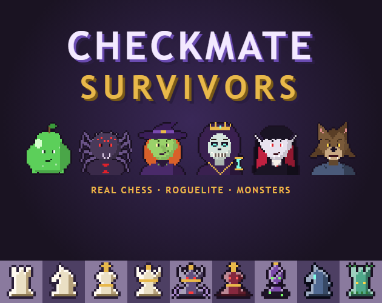
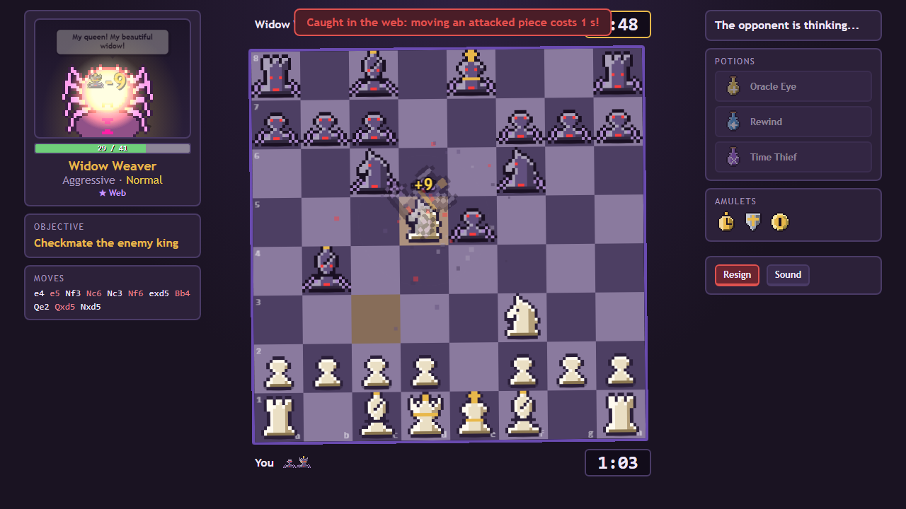
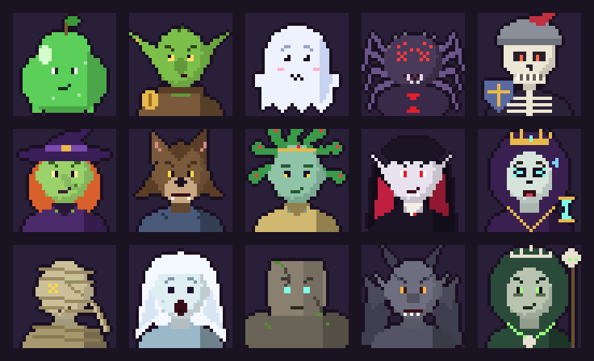
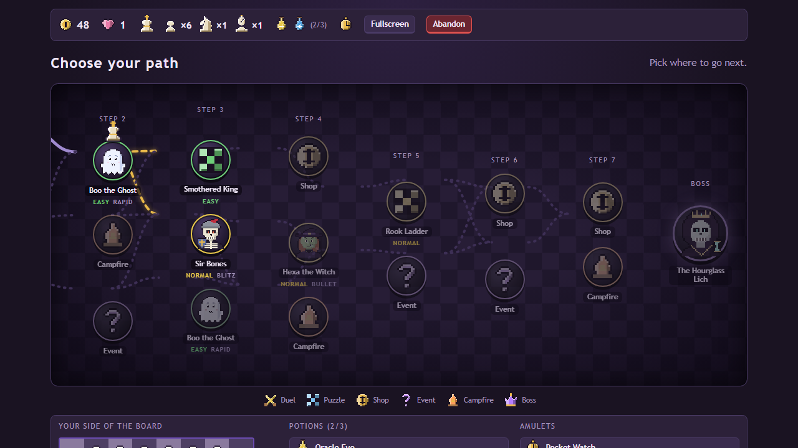
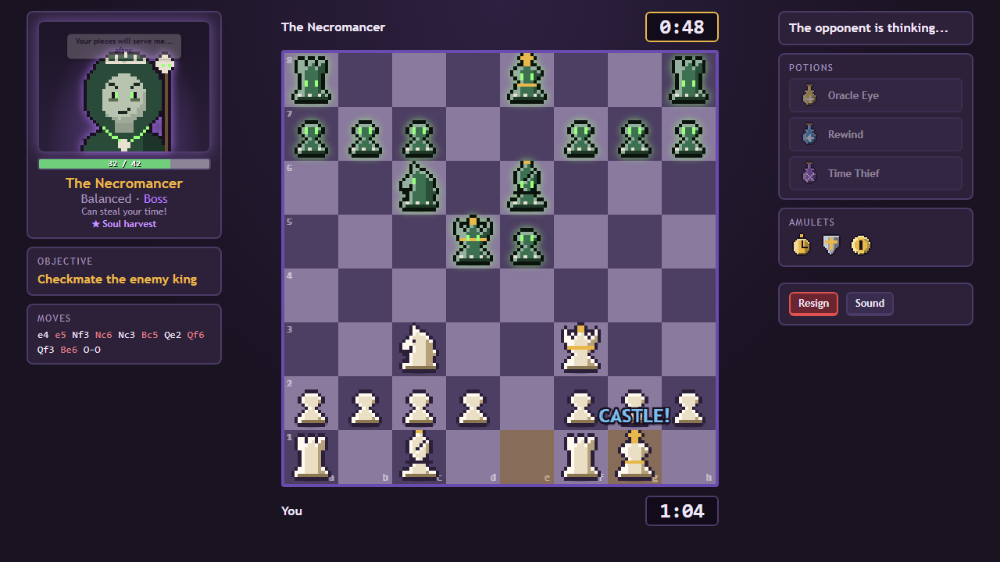
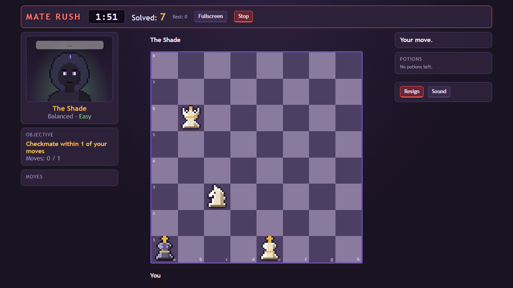
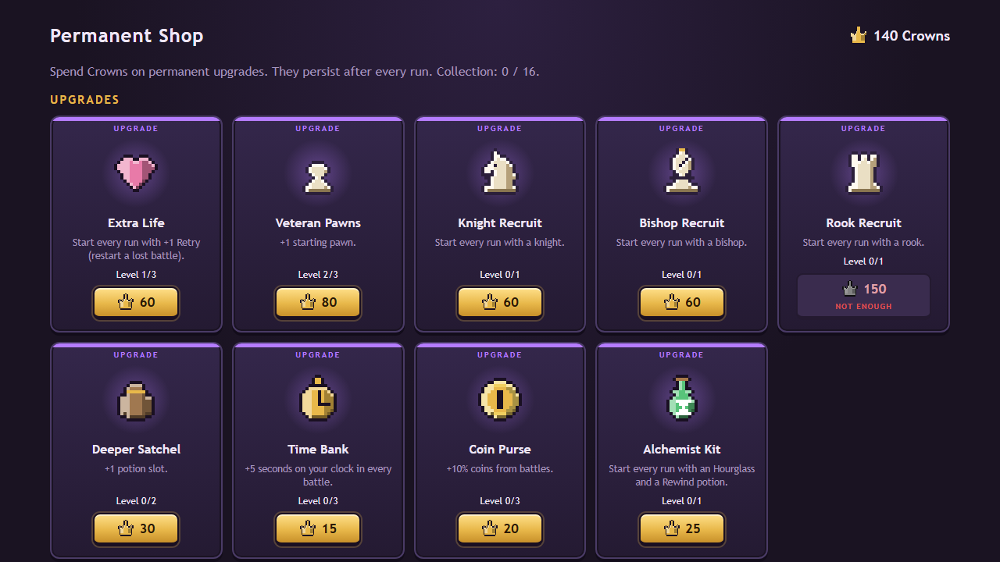

<div align="center">



### Real chess. Roguelite runs. Monsters.

**[▶ Play it free in your browser on itch.io](https://fibonaku.itch.io/checkmate-survivors)**


</div>

---

You start with a king and a handful of pawns. Pick a path across the map, duel a cast of animated monsters against the clock, recruit pieces, brew potions, collect amulets, and come back stronger every time you fall.

**The rules of chess never change.** Real moves, castling, en passant, promotion. The roguelite part is everything *around* the board.

<div align="center">

</div>

## Meet the cast

Fifteen monsters, each with its own AI personality, its own themed chess pieces, a trait that bends the clock or your purse (never the rules), and plenty to say about losing its queen.

<div align="center">

</div>

Gloop the Slime blunders. Grabby the Goblin grabs every piece and pickpockets your coins. The Widow Weaver goes for your king and her web costs you seconds. Count Vlastor drains your clock. The Hourglass Lich has a second phase. And below the Haunted Woods, the Necromancer waits.

## Features

| | |
|---|---|
| 🗺️ **A map of choices** | Duels, puzzles, shops, campfires, strange events, elite fights, the Arena and Mate Rush bonus nodes. |
| ⏱️ **The clock is a resource** | Bullet, blitz or rapid battles. Potions add time, freeze the enemy clock or steal seconds, and some monsters steal them back. |
| 🎯 **Varied objectives** | Checkmate, mate in N, survive N moves, capture the queen, capture N pieces, promote a pawn. |
| 🧩 **Hand-made puzzles** | 15 positions, each one proven solvable by an exhaustive mate solver in the test suite. |
| ⚡ **Mate Rush** | 60 seconds of random mate-in-one puzzles. Every mate pays coins, every wrong move costs 10 seconds. |
| 🏰 **Two acts** | The Haunted Woods and the Catacombs. Beat the Lich, then retire victorious or descend. |
| 👑 **Meta progression** | Earn Crowns every run: extra lives, starting pieces, and an amulet collection you buy once and keep. |
| 📅 **Daily run** | The same seeded map for everyone, every day. Plus 18 achievements. |
| 💥 **Juice** | Particles, flying pieces, screen shake, a toppling king, reactive portraits and synthesized chiptune music. |

<div align="center">




</div>

## Every pixel and every note is code

There are no image or audio files in the game. The whole thing is a folder of plain JavaScript you can open by double-clicking `index.html`: no engine, no build step, no npm, no server.

- **Chess engine** ([`js/chess.js`](js/chess.js)): full rules, make/unmake, SAN, draw detection, verified with perft against reference node counts.
- **AI** ([`js/ai.js`](js/ai.js)): hand-written negamax with alpha-beta, quiescence search and a transposition table. Each monster's "personality" is a set of style weights, so Gloop and the Lich think differently.
- **Pixel art** ([`js/sprites.js`](js/sprites.js), [`js/portraits.js`](js/portraits.js)): 16×16 piece masks with automatic shading and outlines, per-monster piece factions, and 32×32 portraits with six expressions. The GIF above is rendered straight from that code by [`marketing/cast-gif.js`](marketing/cast-gif.js).
- **Sound and music** ([`js/ui.js`](js/ui.js)): sound effects and a small chiptune sequencer, all synthesized with the Web Audio API.
- **Fixed 1280×720 stage** that scales to any window.

## Run it locally

```sh
git clone https://github.com/sk8erlucas/checkmate-survivors.git
```

Then open `index.html` in a browser. That's it.

### Tests

They run with plain Node, no install needed:

```sh
node tests/perft.js       # move generator vs reference node counts
node tests/ai.js          # the AI finds mates and doesn't hang pieces
node tests/scenarios.js   # every puzzle is legal and solvable
node tests/i18n.js        # every text exists in English and Spanish
node tests/smoke.js       # plays full runs through the UI in a fake DOM
node tests/balance.js     # optional and slow: win rates per tier
```

## Project layout

```
index.html      loads the scripts in order
css/style.css   the dark pixel theme
js/             chess, ai, sprites, portraits, data, i18n, ui, match, run, rush, main
tests/          node test scripts
docs/           full game design document (Spanish)
marketing/      itch.io cover, screenshots and page text
```

The full design lives in [`docs/GAME_DESIGN.md`](docs/GAME_DESIGN.md). Notes for AI coding agents are in [`AGENTS.md`](AGENTS.md): the game is built with AI assistance (Claude), directed and play-tested by the author.

## Status

Early alpha. Balance is still being tuned and new monsters keep showing up. Feedback is very welcome in the [itch.io comments](https://fibonaku.itch.io/checkmate-survivors): what felt too hard, which monster you liked, what you want next.

---

<details>
<summary><b>🇦🇷 En español</b></summary>

**Checkmate Survivors** es un roguelite de **ajedrez real** en pixel art. Empezás con un rey y pocos peones, elegís tu camino por un mapa, enfrentás monstruos animados (cada uno con sus propias piezas temáticas) contra el reloj y mejorás de forma permanente cuando caés. Las reglas del ajedrez nunca cambian: lo roguelite está en todo lo que rodea al tablero.

- **Jugalo gratis en el navegador:** <https://fibonaku.itch.io/checkmate-survivors>
- **Jugar en local:** abrí `index.html` con doble clic. No necesita servidor, instalación ni dependencias.
- **15 monstruos** con personalidad, piezas y rasgo propios, **dos actos** (el Bosque Embrujado y las Catacumbas), **15 puzzles**, Mate Rush, la Arena, élites, run del día y **18 logros**.
- Todo el arte y el sonido se generan por código.
- **Diseño completo:** [`docs/GAME_DESIGN.md`](docs/GAME_DESIGN.md).
- **Subir a itch.io:** ejecutá `package-itch.ps1` (genera `dist/checkmate-survivors-html5.zip`) y subilo como proyecto *HTML* marcando "played in the browser".

Idioma por defecto: inglés, con selector de español en el menú.

</details>
